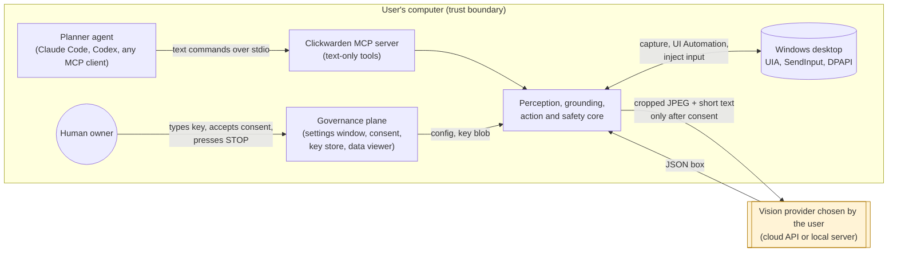
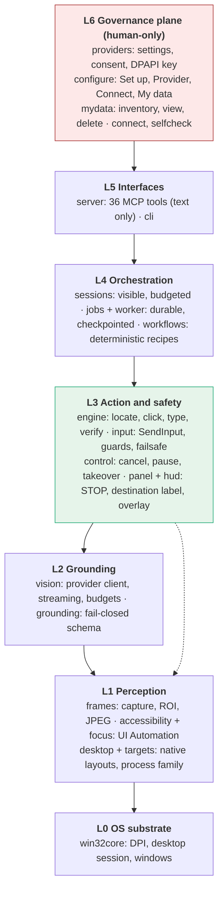
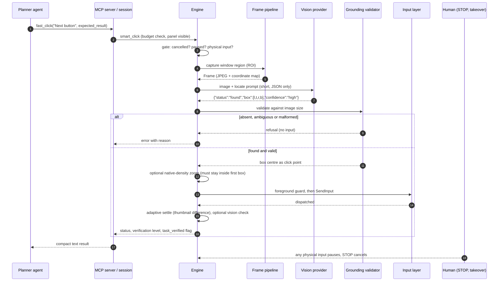
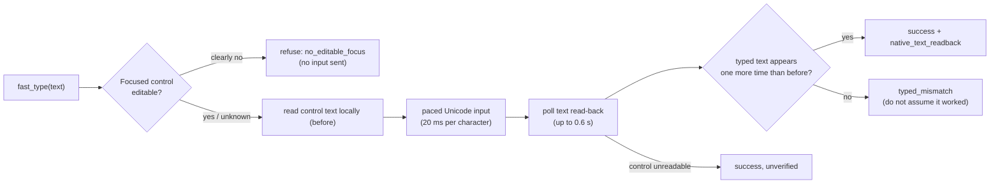
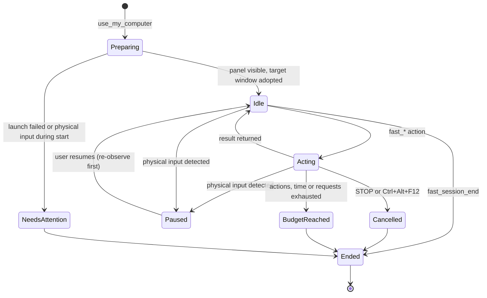
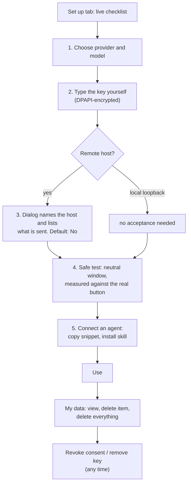

# Clickwarden: Architecture, Design Rationale and Evaluation

*A user-sovereign, cost-separated computer-use layer for Windows, exposed to AI agents over the Model Context Protocol.*

| | |
|---|---|
| **Author** | Kaan Tokgöz (second-year computer engineering student; hobby / research project) |
| **Version described** | 0.1.0 (beta), Apache-2.0 |
| **Platform** | Windows 10/11, Python 3.11+ |
| **Status of claims** | Design claims are argued from the code. Empirical claims are limited to the small, clearly labelled observations in §9; none is a benchmark result. |

> **Reading guide.** §1–3 state the problem and goals. §4 positions the work. §5–7 are the architecture
> (structure, behaviour, decisions). §8 is the threat model and §9 the evaluation. §10–12 cover limitations,
> ethics and future work. §13 is an honest account of how the system was built and what broke. A glossary and a
> module map close the document.

---

## Abstract

Large language model (LLM) agents that operate a graphical desktop ("computer use") conventionally send each
screenshot to the same, expensive, general-purpose model that also plans the task. This couples two jobs with very
different requirements: *planning* needs broad reasoning, whereas *perception* (finding a button in an image) can be
done by a much smaller vision model. Clickwarden separates them. A planner agent of the user's choice (Claude, Codex
or any MCP client) issues short **text** commands; Clickwarden captures the screen, asks a **user-selected** vision
model to ground the target, validates the answer under a fail-closed schema, and injects input into the real desktop
under continuous safety supervision. The planner never receives pixels.

The project's second thesis is *user sovereignty*: because such a tool is invasive by construction, the human, not the
agent, must control where their screen is sent, whether that is accepted, what is stored, and how to stop or delete
everything. The system therefore combines a **perception-and-action pipeline** with a **governance plane** (consent
bound to a destination host, encrypted key storage, inspectable and deletable local data, a persistent stop control,
and rules that agents cannot override). This document describes the architecture, the reasoning behind its main
decisions, the threat model, an initial evaluation and the limits of what has been shown.

---

## 1. Problem statement and intention

### 1.1 The cost and coupling problem

In the dominant design, a frontier multimodal model receives a screenshot every step, decides what to do, and often
also emits raw pixel coordinates. Three consequences follow:

1. **Cost.** Image tokens dominate. A full-window screenshot costs on the order of 2,000 prompt tokens in our
   measurements (§9), and an agent may take dozens of steps.
2. **Coupling.** The planner's quality, price and data-handling terms are tied to the perception component, so the
   user cannot choose a cheap or local model for "where is the button" without changing the planner.
3. **Trust.** The component that decides *what to do* is also the one that sees *everything on screen*, which enlarges
   the privacy surface.

### 1.2 Intention

The author's intention is to make desktop automation **cheaper, more modular and more accountable** by:

* separating *what to do* (planner, text only) from *where it is* (grounder, pixels, cheap or local);
* preferring **non-visual** signals (Windows UI Automation) whenever the application exposes them, since they cost
  nothing and are more reliable than vision;
* treating the machine's owner as the sovereign party, with every consequential choice (provider, key, consent,
  retention, deletion, stopping) made through a human-only surface;
* being **honest about verification**: an input being *dispatched* is not the same as the task being *done*, and the
  system's vocabulary refuses to conflate them.

It is a learning and research project built to understand how computer-use agents actually work, released openly so
that the design can be inspected and criticised.

### 1.3 Research questions and hypotheses

| ID | Question | Hypothesis | Status in this document |
|---|---|---|---|
| RQ1 | Can role separation reduce the cost of computer use without prohibitive accuracy loss? | H1: a small grounding model plus a text-only planner lowers per-step cost; accuracy is adequate for large, labelled targets. | Plausible; only anecdotal measurements (§9). |
| RQ2 | Can an invasive tool give the user real, inspectable control? | H2: consent bound to a host, local-only governance, visible stop and deletion make the data flow legible and revocable. | Argued from design; partly exercised (§8–9). |
| RQ3 | Does a fail-closed grounding contract reduce wrong-target actions? | H3: refusing absent, ambiguous or malformed answers converts model errors into refusals instead of stray clicks. | Argued; unit-tested; not yet measured at scale. |

### 1.4 Non-goals

Not a general OS-agnostic framework; not a sandbox (it acts on the real desktop); not a guarantee of task success;
not a substitute for the planner's judgement; not hardened against a malicious local administrator.

---

## 2. Design goals and constraints

| # | Goal | Consequence for the design |
|---|---|---|
| G1 | **Planner never sees pixels** | The MCP surface is text-only; screenshots are absent from default tools and from job records. |
| G2 | **Fail closed** | Any perception answer that is absent, ambiguous, malformed or out of bounds yields *no input*. |
| G3 | **Human governs the data flow** | Provider, key, consent and deletion live in a human-only settings window; no MCP tool can change them. |
| G4 | **Always stoppable** | A persistent large STOP control, a keyboard abort, corner-slam abort and automatic pause on any physical input. |
| G5 | **Honest verification** | Results carry an evidence level; dispatched-only is never reported as success of the task. |
| G6 | **Cheap by default** | UI Automation before vision; region-of-interest capture; tight output token budgets; tiny JPEGs. |
| G7 | **Inspectable** | Small codebase (~8.7 k lines of Python), no binaries, no telemetry, a single network client for vision. |
| G8 | **Provider-neutral** | Any OpenAI-compatible chat-completions endpoint with image input; cloud or loopback-local. |

Constraints: Windows-only APIs (`SendInput`, UI Automation, DPAPI, Win32 windowing); a *shared* physical cursor
(§7.4); models differ in coordinate conventions and reasoning behaviour (§6.7).

---

## 3. Context and trust boundaries

Four parties and one operating system interact. The dashed boundary marks the user's machine.

**Trust assumptions.**

* The human owner is trusted and is the only principal that may change governance state.
* The planner agent is *semi-trusted*: it is expected to be helpful but may err or be manipulated through on-screen
  content (indirect prompt injection, Greshake et al., 2023). It is therefore never given the ability to widen its own
  privileges.
* Everything rendered on screen is **untrusted data**, never instructions.
* The vision provider is trusted only as far as the user accepted for that host; it is assumed able to retain what it
  receives (free tiers commonly log).
* The local operating system and the user's account are trusted; a malicious administrator is out of scope.

---

## 4. Background and related work

**Computer-use agents.** Commercial systems (e.g., Anthropic's computer use, 2024; OpenAI's computer-using agent)
couple screenshot perception with planning in one model. Benchmarks such as OSWorld (Xie et al., 2024) and WebArena
(Zhou et al., 2023) evaluate end-to-end task success in realistic environments and show that grounding and long-horizon
planning remain difficult.

**GUI grounding.** SeeClick (Cheng et al., 2024) and related models train smaller vision-language models specifically
to map instructions to screen locations; Set-of-Mark prompting (Yang et al., 2023) overlays marks to ease grounding.
These results motivate the premise that *grounding* can be delegated to a smaller specialised model.

**Accessibility-tree agents.** Using the platform accessibility API (here Microsoft UI Automation) avoids pixels
entirely where applications expose controls; its weakness is incomplete or absent trees in canvas, game and some
Chromium/Electron contexts, which is exactly where vision is needed as a fallback.

**Tool protocol.** The Model Context Protocol (Anthropic, 2024) gives a vendor-neutral way to expose tools to agents;
Clickwarden uses its stdio transport so that any compliant client can drive it.

**Agent safety.** Indirect prompt injection (Greshake et al., 2023) is the central risk for agents that read untrusted
content. Classic protection principles apply: least privilege, fail-safe defaults and complete mediation (Saltzer &
Schroeder, 1975).

**Position.** Clickwarden is not a new grounding model or benchmark result. Its contribution is an *integration
architecture*: a role-separated pipeline whose safety and governance properties are first-class, implemented as a
small, auditable system.

---

## 5. Architecture

### 5.1 Layered view

The layering is *conceptual* (arrows show allowed dependency direction, and lower layers never import upper ones).
Two cross-cutting facts matter: the **governance plane (L6)** configures lower layers only through files the human
writes (settings, key blob), never through the MCP surface; and the **safety layer (L3: control, guards, panel)** is
consulted by every action path.

### 5.2 Component responsibilities

| Component | Responsibility | Key invariants |
|---|---|---|
| `win32core` | Per-monitor-v2 DPI awareness, binding threads to the interactive desktop, window and process queries | A DPI-virtualised process would mis-scale every coordinate; this is fixed at start-up. |
| `frames` | Capture the screen or a region into a `Frame`: JPEG bytes plus the exact linear map from image to physical pixels | Any model-returned point converts to a click by one transform; no sub-pixel drift. Modes: precision (native), turbo (≤1280 px), ROI (foveated). |
| `accessibility`, `focus` | Bounded, read-only UI Automation: control names/roles/boxes, focused-control editability, local text read-back | No invoking, no focus stealing; hung providers time out; password fields never read; text never leaves the process. |
| `vision` | Streaming chat-completions client; coordinate-space handling; token budgeting; retry policy | One honest `User-Agent`; extra request fields are validated and cannot override core fields; thinking models get one budget-growth retry. |
| `grounding` | Validate the model's JSON | `found` needs a finite, in-bounds, non-empty box; `absent`/`ambiguous` are refusals; the click point is the **box centre**, a reported point that contradicts the box is rejected. |
| `engine` | One-call primitives: locate, smart-click, type, hotkey, scroll, drag, inspect, batch | Every input passes the foreground guard; uncertain targets get one native-density zoom that must stay inside the first candidate. |
| `input` | `SendInput` batching, corner-slam failsafe, foreground guard, paced Unicode typing | Provenance marker on every injected event so takeover hooks can ignore own input. |
| `control` | Cancellation, pause, budget deadlines, physical-input watch | Real key/mouse presses, wheel or ≥6 px movement pause the job; `Ctrl+Alt+F12` cancels; releases are always delivered. |
| `panel`, `hud` | A persistent, large red STOP, a permanent `Screens → host` label, and a transparent overlay showing the target | The user can see where data goes and stop, at all times. |
| `sessions` | Ad-hoc visible sessions with action, time and request budgets | A panel exists *before* any app is launched; sessions end with a usage summary. |
| `jobs`, `worker` | Durable bounded goals run in an isolated worker process with checkpoints | A crashed worker becomes `interrupted`; resume re-observes, never replays blindly. |
| `providers` | Settings, host-bound consent, DPAPI-encrypted key, disclosure text | Remote hosts need consent for *that host*; loopback needs none. |
| `configure`, `mydata`, `connect`, `selfcheck` | The human-only settings application | Key never displayed; deletion confirmed with default "No"; the app edits no other program's configuration. |
| `server` | 36 MCP tools over stdio | Text-only results; safety notice delivered at connect; no governance tools exist. |

### 5.3 Data stores

| Store | Location | Contents | Sensitivity |
|---|---|---|---|
| Settings and consent | `%USERPROFILE%\.clickwarden\config\config.json` | provider, model, options, accepted host, last safe-test result | low (no secrets) |
| API key | `…\config\key.dpapi` | key encrypted with Windows DPAPI for this user | secret |
| Session and job records | `%USERPROFILE%\.clickwarden\sessions`, `jobs` | action names, statuses, timings, goals, errors (no images) | may reveal window titles and typed text |
| Layouts | `…\layouts` | saved desktop-icon layouts | low |
| Screenshots | `…\shots` (only if the optional export tool is enabled) | JPEGs | high |

The settings location is deliberately **not** `%APPDATA%`. See §13.2 for the incident that motivated this.

---

## 6. Behaviour

### 6.1 The grounded click (core data flow)

Design notes on the flow:

* **Window-scoped capture.** When a target window is known the region of interest is that window only. This reduces
  tokens, reduces the amount of unrelated screen content sent to the provider, and lets the engine reject any
  returned point that falls outside the window.
* **Box, not point.** The validator derives the click from the box centre. A model's separate "point" is accepted only
  if it lies inside the box; otherwise the answer is rejected. This removes a class of inconsistent outputs.
* **One bounded zoom.** For low confidence, small targets, icons or coordinate disagreement, one native-density zoom is
  taken before dispatch; if the zoomed box does not overlap the original, the result is discarded, preventing a jump
  to a different row.
* **No third identical click.** After two observed misses the engine escalates to a supported fallback; it never
  repeats the same failing click indefinitely.

### 6.2 Verification vocabulary

Every action reports *what kind of evidence* supports its result. The scale, from strongest to weakest:

| Level | Meaning | Example |
|---|---|---|
| `native_text_readback` | The focused control's text, read locally via UI Automation, contains what was typed | typing into Notepad |
| `native_position_readback` | Native readback shows the object moved | desktop icon layout |
| `native_control_disappearance` | The exact control vanished from the same window's UI tree | closing a dialog |
| `window_identity_readback` / `window_title_checked` | The intended window is the target / has the expected title | window switch |
| `vision_checked` | A model assessed the visible post-condition (a model judgement, **not** proof) | "different song playing" |
| `observed` | A read-only observation | `fast_inspect` |
| `dispatched_unverified` | Input was delivered; nothing confirms the effect | click without check |
| `unverified` | Refused or failed | refused target |

`success` on an input tool means *dispatched*. Completion of the user's task is a separate claim that the planner
must make from evidence. When a read-back disagrees with what was typed, the tool returns `typed_mismatch` rather than
success (§9.2).

### 6.3 Typing and read-back

The read-back is performed inside the process; the control's contents are compared and discarded, never returned,
logged or sent to the provider. Password fields are never read.

### 6.4 Session lifecycle

Sessions carry three budgets (quick 20 actions/300 s/40 requests; standard 100/1800/160; extended 500/14400/1000) so
a runaway planner terminates by construction. The control panel is created before any application is launched so the
user can stop an action that opens something unexpected.

### 6.5 Durable jobs

For longer autonomous goals, a **job** runs in an isolated worker process with its own panel and a bounded goal, step,
time and request budget. States: `starting → running ⇄ paused → {completed, failed, cancelled, budget_reached, needs_attention,
interrupted}`. If the worker dies, the manager marks the job `interrupted`; **resume re-observes the screen and never
replays the interrupted action blindly**. There is no automatic crash recovery by design: recovery without
re-observation can repeat a destructive step.

### 6.6 Two ways to plan (and why the second is secondary)

The primary mode is **external planning**: the user's agent decides, Clickwarden grounds and acts. The engine also
contains an optional **vision-planned loop** (`fast_task`: observe, ask the vision model for the next action, act,
settle, repeat, bounded by a step limit) for simple goals when no external planner is attached. It reuses every guard
above but concentrates planning and perception in the cheap model, which is less capable and more exposed to
injected screen text, so it is documented as the less trusted path.

### 6.7 Governance flow (setting up and revoking)

Properties enforced by tests: consent is recorded **per host** (changing host re-prompts); the key is stored only as an
encrypted blob and never rendered; deletion touches only a fixed list of known paths and never follows links; the
settings application never edits an agent's own configuration (it shows a snippet for the user to paste).

### 6.8 Provider heterogeneity

Real endpoints differ in ways that break naïve clients, and the client handles each explicitly:

| Variation | Handling |
|---|---|
| Coordinate convention (pixels vs 0–1000 grid) | `coord_space` setting; model answers converted to image pixels before validation. |
| "Thinking" models exhausting the answer budget with empty output | Early stop when an empty reply used ≥90 % of `max_tokens`, then **one** budget-growth retry (×4, capped); per-line stall timer so reasoning streams are not mistaken for a stall. |
| Provider-specific controls (e.g., reasoning off) | Validated `extra_body`; reserved keys (`model`, `messages`, `stream`, `max_tokens`, …) cannot be overridden. |
| Slow or rate-limited free tiers | Configurable timeout (3–120 s); HTTP 429 reported verbatim as a provider limit, not a bug. |
| Logging by free endpoints | Notice shown when the model name ends in `:free` or the host is a known trial API. |

---

## 7. Key design decisions (ADR-style)

Each entry: **decision**, **alternatives considered**, **rationale**, **trade-off**.

### ADR-1 Text-only MCP surface
*Decision:* tools return compact text; screenshots are absent from defaults and job records.
*Alternatives:* return images to the planner (conventional).
*Rationale:* implements G1; reduces planner cost and the privacy surface; makes results auditable as text.
*Trade-off:* the planner cannot "see for itself" and must trust the grounder's textual observations.

### ADR-2 Fail-closed grounding contract
*Decision:* a three-valued `found | absent | ambiguous` schema; refusal on anything else.
*Alternatives:* accept best-effort coordinates; clamp out-of-range values.
*Rationale:* silently clamping onto a neighbouring element is the dangerous failure; refusing converts model error
into a recoverable "no action".
*Trade-off:* more refusals and retries with weak models.

### ADR-3 UI Automation first, vision as fallback
*Decision:* prefer `fast_controls`/`fast_click_control` (re-enumerate, re-check identity, enabled state, bounds and a
centre hit-test, single-use snapshot) before vision.
*Rationale:* free, deterministic, and verifiable (`native_control_disappearance`).
*Trade-off:* coverage varies; in Chromium pages without accessibility enabled the tree was empty in our run (§9.1) and
vision was required.

### ADR-4 Shared real cursor and honest naming
*Decision:* drive the real cursor; pause on any physical input; describe the overlay as a *visual* pointer, not a
second independent cursor.
*Alternatives:* a virtual/background input channel or a VM sandbox.
*Rationale:* works with arbitrary applications and respects the user's authority; takeover is a feature.
*Trade-off:* the user cannot work while it acts (two demo runs failed because the author typed during them), and it is
unsafe to describe this as background-safe control.

### ADR-5 Consent bound to the destination host
*Decision:* acceptance is stored for one exact host; any change re-prompts; the dialog defaults to **No** and lists
exactly what is sent.
*Alternatives:* one global "I agree"; typed host name.
*Rationale:* the user agrees to a *recipient*, not an abstraction; typed confirmation was judged user-hostile in
testing.
*Trade-off:* repeated prompts when switching providers.

### ADR-6 Governance is unreachable from the agent
*Decision:* no MCP tool configures providers, keys or consent; the server's connect-time notice and `AGENTS.md` forbid
agents from attempting it; environment-variable overrides exist for automation but are documented as the user's.
*Rationale:* an agent that can grant itself consent defeats the model.
*Trade-off:* a human must complete setup.

### ADR-7 Settings under the user profile, not AppData
*Decision:* store configuration in `%USERPROFILE%\.clickwarden\config`.
*Rationale:* packaged (MSIX) desktop apps give child processes a **redirected private copy** of AppData; a settings
window started from the desktop and an MCP server started by such an app then see *different files* (§13.2).
*Trade-off:* a dot-folder in the profile instead of the conventional location; a one-time migration moves old files.

### ADR-8 Paced character-at-a-time typing by default
*Decision:* send each character as its own `SendInput` with a 20 ms gap; keep single-burst typing as an opt-in.
*Rationale:* measured corruption in the current Notepad under bursts and sub-20 ms gaps (§9.2).
*Trade-off:* ~50 characters/s instead of near-instant.

### ADR-9 Local read-back instead of a second vision call
*Decision:* verify typing with a UI Automation text read, compared in-process.
*Rationale:* ~23 ms, no tokens, no data leaves the machine.
*Trade-off:* unavailable for canvas/unreadable controls; then the result stays `unverified`.

### ADR-10 Separate worker process for durable jobs
*Decision:* each job runs in its own process with its own panel; state in atomic JSON files.
*Rationale:* a crashed or hung worker cannot take down the server; crash is observable as `interrupted`.
*Trade-off:* inter-process polling and file-based state.

### ADR-11 Evidence-labelled results over booleans
*Decision:* report an enumerated evidence level (§6.2) and a `task_verified` flag.
*Rationale:* prevents the common failure of treating "click sent" or "model says done" as success.
*Trade-off:* verbose results the planner must interpret.

---

## 8. Threat model and safety analysis

### 8.1 Assets
(A1) the user's signed-in accounts and data on screen; (A2) the API key; (A3) what the provider learns from
screenshots; (A4) local records of past activity; (A5) the integrity of the user's files and settings.

### 8.2 Adversaries
(T1) hostile on-screen content steering the planner (indirect prompt injection); (T2) a careless or over-eager planner;
(T3) a curious or logging provider; (T4) another local program trying to use the key or settings; (T5) a model error
(not malicious) that produces a wrong target.

### 8.3 Threats and controls

| Threat | Asset | Controls | Residual risk |
|---|---|---|---|
| Injected text on a page tells the agent to act (T1) | A1, A5 | Screen text is declared untrusted in the connect-time notice and skill; agent rules require confirmation before irreversible actions; foreground guard; budgets | **High, inherent to LLM agents.** Rules are advisory to the planner; the system cannot enforce comprehension. Do not use on sensitive accounts. |
| Wrong window receives input (T2/T5) | A1, A5 | Foreground guard arms the expected window and refuses on mismatch; window-pinned grounding rejects points outside the window | Race between check and injection is narrow but non-zero. |
| Wrong element clicked (T5) | A5 | Fail-closed schema; box-centre rule; bounded zoom; two-miss escalation | Confident wrong boxes pass validation. |
| Planner grants itself consent or changes provider (T2) | A2, A3 | No governance tools; notice and rules; consent per host | Env-var overrides exist for the user; an agent with a shell could set them, which the rules forbid and which cannot be technically prevented from within the same user account. |
| Provider retains screenshots (T3) | A3 | Consent dialog names host; free-endpoint warning; window-scoped ROI; local-model option; visible destination label | Data already sent cannot be recalled. |
| Key theft by local software (T4) | A2 | DPAPI (bound to the Windows user); never rendered; paste limits; no key in logs or results | Any process running as the same user can call DPAPI decrypt. |
| Runaway or loop | A5 | Action, time and request budgets; physical-input pause; STOP; `Ctrl+Alt+F12`; corner slam | The user must be present. |
| Over-retention of records | A4 | Records contain no images; My data tab lists, views and deletes everything | Typed text may appear in records; user is told. |
| Stale or mismatched settings (operational) | A2, A3 | Single shared config location; unreadable-path reporting | See §13.2. |

### 8.4 Safety properties tested offline
Foreground-change refusal; takeover pauses and releases; refusal on absent/ambiguous/malformed grounding; consent is
host-bound and default-denied; key never in `describe()` or checklist output; deletion confined to known paths and link-
safe; paste limits (a pasted code sample once froze the settings window and is now refused); skill installation refuses
to write through a link.

---

## 9. Evaluation

### 9.1 What was observed (anecdotal, small n)

These are development observations on one machine with one cheap free vision model (Nemotron 3.5 Super VL, free tier,
reasoning disabled, coordinates as a 0–1000 grid). They illustrate behaviour; they are **not** benchmark results.

| Observation | Value |
|---|---|
| Grounding accuracy on a neutral test window | Returned click point 2–5 px from the true button centre in passing runs |
| Safe-test pass rate | 2 of 4 runs passed end to end; failures were model answers (empty locate once, OCR mismatch once), not code faults |
| Vision latency (small window crop) | ≈1.1–2.8 s typical; one 4.6 s; first call on a full Chrome window 15.9 s (free tier variance) |
| Tokens per call | ≈600 prompt for a 560×340 window; ≈2,090 for a full Chrome window; 20–60 completion |
| Task: type a phrase in Notepad | Completed after fixing a typing defect; final title bar confirmed the text (objective check) |
| Task: skip a track in an open YouTube Music tab (Chrome) | Completed through the vision fallback; UI Automation exposed no "Next" control in that page; total ≈9 k prompt tokens over 5 requests; click result flagged `task_verified:false` though the follow-up read confirmed the change |
| Typing corruption | Burst or ≤3 ms gaps in the new Notepad produced dropped/repeated characters (`hello nnnnnnnn…`); 20 ms/character was correct |

### 9.2 Defects found by live use (and what they show)

1. **Typing burst corruption.** Unit tests passed while a real application corrupted input, which motivated both the
   pacing default (ADR-8) and read-back verification (ADR-9). *Lesson:* offline tests cannot establish effect
   correctness; evidence-labelled results are necessary.
2. **Redirected AppData.** Two views of "the same" folder existed (ADR-7, §13.2).
3. **Self-inflicted pauses.** Typing at the keyboard during a run triggered the takeover pause by design, which looked
   like a failure to the observer. *Lesson:* the human-takeover feature needs clear on-screen status and user guidance.

### 9.3 Proposed evaluation protocol (not yet run)

To turn H1 and H3 into measured claims:

* **Task set.** 30–50 small, scriptable tasks on a **disposable fixture** application (seeded layout, receipt oracle),
  e.g., open, search, rename, fill a form, change a setting. The repository already includes a fixture and
  `benchmarks/baseline.py`.
* **Outcome vocabulary.** `success`, `missing_target`, `declined`, `wrong_dispatch`, `unknown`, with `false_success`
  tracked separately and **scored from fixture-side receipts**, never from a model's or caller's claim.
* **Independent variables.** Grounding model (free cloud, paid cloud, local); perception path (UIA-first vs
  vision-only); coordinate space; ROI vs full screen; paced vs burst typing.
* **Dependent variables.** Success rate, false-success rate, refusals, vision calls and tokens per task, estimated
  cost per task, latency percentiles, human interventions.
* **Baselines.** (a) the same tasks driven by a frontier model with direct screenshots; (b) UIA-only.
* **Statistics.** Report counts with exact binomial confidence intervals; ≥3 seeds per condition; pre-register the task
  list to avoid post-hoc selection.
* **Threats to validity.** Fixture realism; model and endpoint drift (free tiers change); single-machine effects
  (DPI, theme); author-written tasks; small n.

### 9.4 Engineering evidence
~8.7 k lines of Python in 29 modules, no binary blobs; 36 MCP tools; **316 offline test cases** run in CI on Windows for Python 3.11–3.13 with no input injection and no network. The live
tests are opt-in and use disposable windows.

---

## 10. Limitations and failure modes

* **Accuracy ceiling** set by the grounding model; weak models cause refusals, retries and occasionally confident
  wrong boxes.
* **Shared cursor.** No parallel human work; not background-safe; a second monitor, scaling or an unusual theme can
  change behaviour.
* **Latency.** Multi-second vision calls make it slower than native computer use per step on free tiers.
* **Verification gaps.** Many actions end `dispatched_unverified`; vision checks are model assessments.
* **Injection is not solved.** Rules and confirmations reduce, but cannot eliminate, the risk of manipulated agents.
* **Coverage.** Canvas, games, CAD and elevated (administrator) windows are largely out of scope; the input layer
  cannot inject into higher-integrity windows.
* **Platform.** Windows only. The code is vibe-coded and has had no independent security audit.

---

## 11. Ethics, privacy and responsible release

* **Dual use.** The same capability that automates chores can automate abuse. The project documents intended use
  (own computer, own accounts), forbids deceptive client identity, ships no evasion features, and states plainly what
  it can do to the user's accounts.
* **Honest identity.** Requests carry `User-Agent: clickwarden/<version>`; there is no impersonation of another
  vendor's client, and a hygiene test fails the build if such strings appear.
* **Data minimisation.** Window-scoped capture, no images in records, no telemetry, local-only governance.
* **Transparency.** The README leads with warnings; the connect-time notice repeats them to the agent; the panel shows
  the destination permanently.
* **Authorship and provenance.** The implementation was produced with substantial AI assistance and is released as a
  hobby project with that disclosed; third-party dependencies are permissively licensed and listed.
* **Licence.** Apache-2.0, chosen over MIT for its express patent grant and explicit contributor terms, relevant to
  a tool in a contested area.

---

## 12. Future work

1. Run the §9.3 protocol and publish results, including failures.
2. A "plan mode" confirmation gate: irreversible-action classes enforced in code (e.g., submit/send/delete on
   known controls) rather than only requested of the planner.
3. Per-window allow-lists so a session cannot leave a user-named application.
4. Hybrid grounding: UIA candidate boxes passed to the model to pick among (Set-of-Mark style) before pure pixels.
5. A local grounding model profile (quantised GUI-grounding model) with measured accuracy and latency.
6. An independent security review and fuzzing of the JSON/box parser and the settings validators.
7. Optional second-desktop or VM isolation to remove the shared-cursor constraint.
8. Cross-platform back-ends (macOS accessibility, X11/Wayland portals) behind the same L1/L3 interfaces.

---

## 13. Process and lessons learned

### 13.1 Method
Development was iterative and test-led: write a small change, add offline unit tests, then exercise it live on
disposable windows before touching real applications; keep a strict separation between what is *argued*, *tested
offline* and *observed live*.

### 13.2 Incident: the invisible settings folder
After saving settings through a process started by the desktop AI app, the human-run settings window reported "nothing
stored" and the "open folder" button silently failed (File Explorer: *Location is not available*). The evidence is
consistent with packaged-app **file-system redirection**: processes started by the packaged app saw a private copy of
`%APPDATA%`, while Explorer-launched processes saw the real folder; `%USERPROFILE%\.clickwarden` was identical in
both. (The cause is inferred from behaviour, not confirmed at the operating-system level.) The remedy was to move
settings to a shared location, add an automatic one-time migration, report unreadable paths explicitly, and surface
button errors on the correct tab. *Lesson:* configuration shared between a GUI and a tool server must live where all
launch paths can see it, and failures must be shown, not swallowed.

### 13.3 Incident: green tests, wrong text
See §9.2(1): correctness of *effects* required live checks and led to evidence-labelled verification.

### 13.4 Incident: tests reading the developer's real settings
A unit test failed only after the author saved a different model, because it read the live configuration. Tests now
run against an isolated configuration directory. *Lesson:* hermetic tests are part of the safety story.

---

## Glossary

**Grounding.** Mapping a natural-language description to a location in an image. **Planner.** The agent that decides
what to do. **MCP.** Model Context Protocol, a tool interface for agents. **UIA.** Microsoft UI Automation, the
accessibility API. **ROI.** Region of interest. **DPAPI.** Windows Data Protection API. **Fail-closed.** On uncertainty,
take no action. **Takeover.** Pausing automation when a human uses the mouse or keyboard. **Evidence level.** The kind
of proof behind a result (§6.2).

## Appendix A. Module map

| Module | Lines | Role |
|---|---:|---|
| `configure.py` | ~760 | Settings application (Set up, Provider, Connect, My data) |
| `sessions.py` | ~925 | Visible, budgeted sessions |
| `engine.py` | ~900 | Locate/click/type/verify primitives |
| `input.py` | ~700 | SendInput, failsafe, foreground guard |
| `hud.py` | ~650 | Transparent overlay |
| `vision.py` | ~555 | Provider client |
| `server.py` | ~550 | 36 MCP tools |
| `win32core.py` | ~410 | DPI, desktop session, windows |
| `providers.py` | ~385 | Settings, consent, key |
| `worker.py` / `jobs.py` | ~560 | Durable jobs |
| `frames.py` | ~340 | Capture pipeline |
| `focus.py`, `accessibility.py` | ~350 | UI Automation reads |
| `cli.py`, `connect.py`, `mydata.py`, `panel.py`, `control.py`, `desktop.py`, `targets.py`, `workflows.py`, `grounding.py`, `selfcheck.py`, `diagnostics.py` | ~1,550 | Interfaces, governance helpers, safety, native workflows |

## Appendix B. MCP tool groups (36 tools)

* **Session and status:** `use_my_computer`, `fast_session_start`, `fast_session_status`, `fast_session_control`,
  `fast_session_end`, `fast_capabilities`, `hud_status`.
* **Perception (read-only):** `fast_inspect`, `fast_locate`, `fast_controls`, `list_windows`, `get_screen_info`,
  `fast_find_files`, `fast_desktop_inventory`.
* **Action:** `fast_click`, `fast_click_control`, `fast_type`, `fast_hotkey`, `fast_scroll`, `fast_drag`, `fast_move`,
  `fast_batch`, `fast_navigate`, `fast_web_search`, `fast_switch_window`, `focus_window_by_title`,
  `fast_desktop_arrange`, `fast_desktop_undo`.
* **Autonomy:** `fast_task` (vision-planned loop), `fast_job_start`, `fast_job_status`, `fast_job_list`,
  `fast_job_pause`, `fast_job_resume`, `fast_job_cancel`.
* **Diagnostics:** `fast_bench`.

There is deliberately **no** tool for choosing a provider, setting a key, accepting data sharing or deleting data.
Authoritative signatures: [TOOLS.md](TOOLS.md).

## References

1. Anthropic. *Model Context Protocol specification.* 2024. https://modelcontextprotocol.io
2. Anthropic. *Introducing computer use.* Announcement, October 2024.
3. Xie, T., et al. *OSWorld: Benchmarking Multimodal Agents for Open-Ended Tasks in Real Computer Environments.*
   NeurIPS 2024 (Datasets and Benchmarks).
4. Zhou, S., et al. *WebArena: A Realistic Web Environment for Building Autonomous Agents.* ICLR 2024.
5. Cheng, K., et al. *SeeClick: Harnessing GUI Grounding for Advanced Visual GUI Agents.* ACL 2024.
6. Yang, J., et al. *Set-of-Mark Prompting Unleashes Extraordinary Visual Grounding in GPT-4V.* arXiv:2310.11441, 2023.
7. Greshake, K., et al. *Not What You've Signed Up For: Compromising Real-World LLM-Integrated Applications with
   Indirect Prompt Injection.* AISec 2023.
8. Saltzer, J. H., and Schroeder, M. D. *The Protection of Information in Computer Systems.* Proceedings of the IEEE,
   63(9), 1975.
9. Microsoft. *UI Automation overview* and *CryptProtectData (DPAPI)* documentation, Windows developer documentation.

> **Citation note.** References 2–7 were written from the author's recollection of the literature; verify titles,
> venues and years against the originals before submission.
